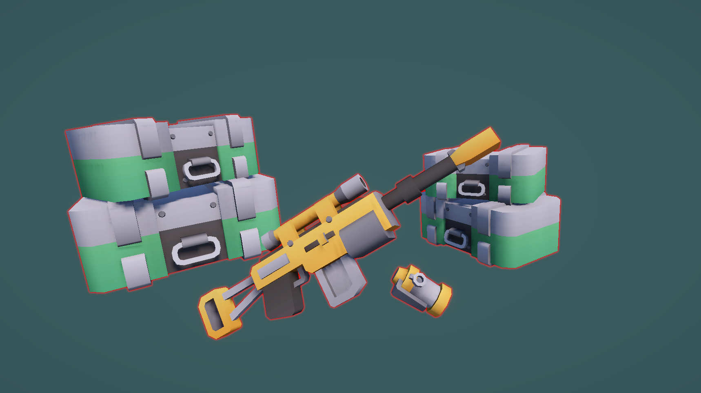

## Glowing Outlines
Glowing Outline Scriptable Render Feature using Render Graph 

### About:
TBD

### Installation: 
- In Unity go to Windows -> Package Management -> Package Manager
- Press the + icon and select Install package from git URL
- Paste https://github.com/DanWestonCode/glowing-outlines.git

### How to use:
The project also comes with a sample demo project with a Demo Scene. This sample also includes the Materials you will need to create for the Render Feature to work.

- Add a `GlowingOutlinesScriptableRenderFeature` instance to your Universal Renderer.
- Define/create the Layer for outlines and configure on the `GlowingOutlinesScriptableRenderFeature` instance.
- Create three Materials, `Composite.shader`, `GaussianBlur.shader` and `Mask.shader`.
- Hook these Materials up on the `GlowingOutlinesScriptableRenderFeature` instance.
- Set objects in the scene to use your defined layer.
- `GlowingOutlinesScriptableRenderFeature` comes with several parameters which you can edit on the `GlowingOutlinesScriptableRenderFeature` instance.

### References
- [Write a render pass using the render graph system in URP](https://docs.unity.com/ko-kr/engine/6000.0/manual/render-pipelines/universal-render-pipeline/customizing-urp/render-graph/write-render-pass)
- [Particles Color and Depth Textures](https://catlikecoding.com/unity/tutorials/custom-srp/particles/)
- [baba-s/GaussianBlur.shader](https://gist.github.com/baba-s/880fdf600a65655f8a2252c275e9a747)

### Licence

Copyright (c) 2026 Daniel Weston

Permission is hereby granted, free of charge, to any person obtaining a copy
of this software and associated documentation files (the "Software"), to deal
in the Software without restriction, including without limitation the rights
to use, copy, modify, merge, publish, distribute, sublicense, and/or sell
copies of the Software, and to permit persons to whom the Software is
furnished to do so, subject to the following conditions:

The above copyright notice and this permission notice shall be included in all
copies or substantial portions of the Software.

THE SOFTWARE IS PROVIDED "AS IS", WITHOUT WARRANTY OF ANY KIND, EXPRESS OR
IMPLIED, INCLUDING BUT NOT LIMITED TO THE WARRANTIES OF MERCHANTABILITY,
FITNESS FOR A PARTICULAR PURPOSE AND NONINFRINGEMENT. IN NO EVENT SHALL THE
AUTHORS OR COPYRIGHT HOLDERS BE LIABLE FOR ANY CLAIM, DAMAGES OR OTHER
LIABILITY, WHETHER IN AN ACTION OF CONTRACT, TORT OR OTHERWISE, ARISING FROM,
OUT OF OR IN CONNECTION WITH THE SOFTWARE OR THE USE OR OTHER DEALINGS IN THE
SOFTWARE.